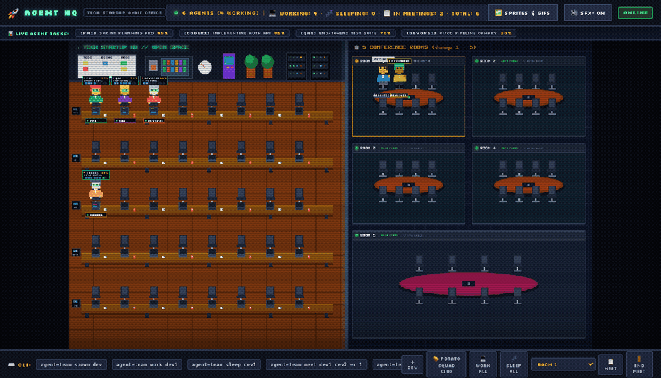

# 👾 Agent Team - 8-Bit Virtual Office CLI, MCP & Web Server

**Agent Team** is a real-time, interactive **8-bit Pixel Art Office Simulator** designed for AI Agents (including Claude Code, Autonomous Subagents, Dev Agents, and Potato-Skill Agents). It visualizes your AI agents coding at desks, walking across hallways to consult teammates, holding meetings in conference rooms, waiting in queues, and taking breaks on an animated web canvas, accompanied by retro synth audio and a built-in background daemon.



---

## 🌟 Key Features

### 1. 🏢 Tech Startup Open-Plan Office & 5 Conference Rooms
- **Open-Space Workspace (Left Canvas)**:
  - **5 Long Workbenches**: Each workbench seats **8 agents** (accommodating up to 40 agents simultaneously):
    - `Bench 1`: Core Tech & Product
    - `Bench 2`: Frontend & UI
    - `Bench 3`: Backend & API
    - `Bench 4`: AI & Data / QA
    - `Bench 5`: DevOps & Infra / SRE
  - **Desk Equipment**: Laptops with animated code displays, color-coded office chairs, hot coffee mugs, and energy drink cans.
  - **Desk Nameplates**: Every agent's name is rendered cleanly in front of their workspace.
  - **Startup Decor**: Kanban whiteboard (TODO, DOING, PROD), coffee & beverage bar, glowing neon `MOVE FAST & BREAK THINGS` sign, retro arcade cabinet, Monstera plants, and blinking server racks.
- **5 Executive Conference Rooms (Right Canvas)**:
  - **Rooms 1 to 5**: Each room seats up to **8 agents** (supporting up to 40 concurrent meeting attendees):
    - `Room 1`: Executive Suite 1
    - `Room 2`: Executive Suite 2
    - `Room 3`: Executive Suite 3
    - `Room 4`: Executive Suite 4
    - `Room 5`: Main Boardroom (Large all-hands boardroom)
  - **Meeting Equipment**: Oval executive wooden table, central conference microphone, 8 chairs, status LED (Green = Available, Amber = In Session, Blinking Red = Full 8/8), and active meeting topic marquee.
  - **Meeting Badges**: Name badges placed around the conference table for all attendees.

---

### 2. 🪪 High-Legibility Pixel Identity
- 100% unobstructed text: agent names and task HUDs never collide with laptops or furniture.
- Rendered in sharp, pixel-perfect `Silkscreen` retro typography with high-contrast badge borders.

---

### 3. 📊 Task HUD & Progress Bars
- When an agent is working (`status: working`), an overhead HUD box displays:
  - **Agent Name & Role Color**
  - **Completion Percentage (0 - 100%)**
  - **8-Bit Progress Bar** (Yellow while working, vibrant green upon 100% completion)
  - **Current Task Description**

---

### 4. 🚶 Desk Visit & Walk-to-Consultation System
- Agents can **get up from their desk and walk along aisles and hallways** to another agent's desk using 8-bit walking animations (swinging arms, stepping legs, head bob).
- **Consultation Stance**: The visitor stands beside the teammate's desk holding a clipboard/notepad.
- **Staggered Dual Bubbles**:
  - Visitor displays an overhead Question Bubble: `❓ [QUESTION]`
  - Host seated at the desk displays an overhead Reply Bubble: `💡 [REPLY]`
  - Horizontally staggered so dialogue remains completely legible without overlap.
- **Smart Contextual Reply**: If no custom reply is provided, the host agent automatically replies with their active task context.
- **Chair Lifecycle**: The visitor's home chair remains empty while visiting, and is re-occupied when they return.
- **Auto-Return & Manual Return**: Automatically walks back to their home desk when the timer expires (default: 12s), or when `agent-team return <name>` is called.

---

### 5. 🚦 Conference Rooms & Auto-Admit Waiting Queue
- When a conference room reaches capacity (8/8 seats), any subsequent meeting request is automatically assigned to a **Waiting Queue** with a unique Queue ID (e.g. `Q-860`).
- Queued agents wait patiently at their desks in `waiting` status with an amber `⏳ QUEUE FOR RM X` badge.
- **Auto-Admit Engine**: As soon as the current meeting ends (`agent-team end-meeting -r <room>`), the next queued team is **automatically admitted into the conference room**!

---

### 6. 👥 1:1 Real Agent Lifecycle & 8-Bit Smoke Puff Dismissal
- The virtual office only renders agents that are currently active in your workflow.
- When an agent finishes their job, the `dismiss` command removes them with an animated 8-bit smoke puff particle effect.

---

### 7. 🔌 Model Context Protocol (MCP) Server
- Native stdio MCP server for **Claude Code**, **Claude Desktop**, **Cursor**, and other MCP-compatible IDEs.
- Exposes 16 high-level tools with full parameter validation and typed JSON responses.

---

### 8. 🏃 Agile Sprint Ceremonies Engine (8 Mandatory Phases)
The core operating model of Agent Team is facilitating autonomous **Sprint Ceremonies**:
1. **Story Validation & Refinement**: PO (`product-manager`) brings user story cards to Lead Dev (`coder`) and Architect (`system-architect`) in Room 2 to validate acceptance criteria and technical feasibility.
2. **Backlog Grooming & Point Estimation**: Devs, QA (`qa-tester`), Architect, and PO meet in Room 1 to discuss edge cases, test scenarios, and agree on story point estimates.
3. **Sprint Planning & Task Distribution**: The entire multidisciplinary squad gathers in the Room 5 Boardroom to decompose task DAG waves and distribute commitments.
4. **Sprint Execution (Active Work)**: All agents return to their respective workbenches across Benches 1-5 with typing animations, glowing screens, and floating task HUDs.
5. **Sprint Feature Demo**: Coder, UI/UX Designer, QA, and PO assemble in Room 3 for live feature demonstration and walkthrough.
6. **UAT Verification & Formal Sign-Off**: PO and QA review acceptance criteria against test results in Room 2 to grant official UAT sign-off before production.
7. **Production Release & Canary Rollout**: DevOps and SRE deploy the release artifact to production in Room 4 with automated canary verification.
8. **Sprint Retrospective**: All agents gather in Room 5 Boardroom to analyze issues encountered, review lessons learned, and commit to continuous improvements for the next sprint.

---

## 🚀 Getting Started

### Prerequisites
- **Node.js**: v18 or higher
- **npm**

### Installation
```bash
git clone https://github.com/kungpotato/agent_team.git
cd agent_team
npm install
npm run build
```

### Launch the Virtual Office
```bash
# Starts the server and opens http://localhost:3333 in your default browser
node bin/agent-team.js open
# or
node bin/agent-team.js start --open
```

> **Note**: The CLI includes a **Background Auto-Daemon**. If the server is not running when you execute any CLI or MCP command, it will automatically launch the server in the background for you!

---

## 🧩 Claude Code Plugin Architecture

`agent-team` is fully packaged as a **native Claude Code plugin** complying with the official [Claude Code Plugin Specification](https://code.claude.com/docs/en/plugins/overview).

```
agent_team/
├── .claude-plugin/
│   └── plugin.json            # Plugin manifest (name, version, metadata, components)
├── .mcp.json                  # MCP Server declaration (19 office & sprint tools)
├── skills/
│   ├── sprint/SKILL.md        # /agent-team:sprint (8-phase Agile sprint ceremony governance)
│   ├── backlog/SKILL.md       # /agent-team:backlog (Taskwarrior default & Jira cards)
│   ├── office/SKILL.md        # /agent-team:office (Desk visits, meetings, rooms 1-5, clock out)
│   └── governance/SKILL.md    # /agent-team:governance (Mandatory sprint policy enforcement)
├── agents/
│   ├── scrum-master.md        # @agent-team:scrum-master (Agile ceremony facilitator)
│   ├── product-owner.md       # @agent-team:product-owner (Story AC validation & UAT sign-off)
│   ├── system-architect.md    # @agent-team:system-architect (Contract validation & canary rollout)
│   └── qa-tester.md           # @agent-team:qa-tester (Edge-cases & acceptance testing)
├── hooks/
│   └── hooks.json             # Lifecycle hooks (SessionStart sprint status checks)
└── bin/                       # Executables placed on PATH when plugin is active
```

### Loading the Plugin in Claude Code

You can run Claude Code with the plugin loaded immediately without publishing:

```bash
# Load for a single session
claude --plugin-dir /Users/kittisak/workspace/agent_team

# Validate the plugin anytime
claude plugin validate /Users/kittisak/workspace/agent_team
```

Once loaded:
- **Skills** become available as `/agent-team:sprint`, `/agent-team:backlog`, `/agent-team:office`, `/agent-team:governance`
- **Subagents** become available as `@agent-team:scrum-master`, `@agent-team:product-owner`, etc.
- **MCP Server** (`plugin:agent-team:agent-team`) automatically connects all 19 office simulation tools.

---

## 🔌 Model Context Protocol (MCP) Integration for Claude

The fastest and most reliable way for Claude to control the office is via MCP.

### 1. Adding to Claude Code (Terminal CLI)
Run this single command in your terminal:
```bash
claude mcp add agent-team node /Users/kittisak/workspace/agent_team/bin/agent-team-mcp.js
```
*Or run directly via project executable:*
```bash
claude mcp add agent-team node /Users/kittisak/workspace/agent_team/bin/agent-team.js mcp
```

### 2. Adding to Claude Desktop (`claude_desktop_config.json`)
Open your Claude Desktop configuration (macOS: `~/Library/Application Support/Claude/claude_desktop_config.json`):
```json
{
  "mcpServers": {
    "agent-team": {
      "command": "node",
      "args": [
        "/Users/kittisak/workspace/agent_team/bin/agent-team-mcp.js"
      ]
    }
  }
}
```

### 3. 🛡️ Mandatory Ceremony Enforcement for Claude (`CLAUDE.md`)
Whenever Claude or any AI agent uses this project or its MCP tools, **it is strictly bound by the governance policy defined in [`CLAUDE.md`](CLAUDE.md)**:
- **Strict Ceremony Sequence**: All agent collaboration must execute the 8 ceremonies sequentially (`validation` ➔ `grooming` ➔ `planning` ➔ `working` ➔ `demo` ➔ `uat` ➔ `release` ➔ `retro`).
- **No Early Coding**: Agents are programmatically blocked from jumping straight to active coding before Story Validation, Backlog Grooming, and Sprint Planning have completed.
- **No Release Without UAT**: Production release (Phase 7) is blocked and will throw a policy error if formal UAT Sign-Off (Phase 6) has not been granted.
- **Mandatory Retrospective**: Retrospective (Phase 8) in the Main Boardroom is required to extract lessons learned after each release.

---

### MCP Tools Reference (19 Tools)

| Tool Name | Description | Key Parameters |
|---|---|---|
| `office_get_cards` | List story cards from the backlog (Taskwarrior default, or Jira) | `source` (`taskwarrior` default, or `jira`) |
| `office_add_card` | Add a new story card into the backlog (Taskwarrior default) | `title`, `points`, `tags`, `priority`, `source` |
| `office_sprint_start` | Start a new Sprint cycle with card from Taskwarrior (default), Jira, or manual story | `sprint_number`, `card_id`, `source`, `story`, `points` |
| `office_sprint_ceremony` | Execute a ceremony: `validation`, `grooming`, `planning`, `working`, `demo`, `uat`, `release`, `retro` | `phase`, `points`, `topic` |
| `office_sprint_next` | Advance to the next sprint ceremony in sequence (1 -> 8 -> complete) | `{}` |
| `office_sprint_complete` | Complete and archive the current sprint cycle after Retrospective (syncs card to done) | `summary` (Optional) |
| `office_sprint_status` | Retrieve current sprint details, card source badge, pipeline progress, and history | `{}` |
| `office_set_work` | Assign an agent to work on a task with progress % (Auto-spawns agent if absent) | `agent_name`, `task`, `progress` (0-100) |
| `office_update_progress` | Update completion percentage and task description | `agent_name`, `progress`, `task` |
| `office_desk_visit` | Send an agent walking over to another desk to ask questions | `from_agent`, `to_agent`, `question`, `reply`, `duration`, `stay` |
| `office_return_to_desk`| Order a visiting agent to return to their home desk | `agent_name` |
| `office_start_meeting` | Move agents into Room 1-5 (Auto-queues if 8/8 full) | `agents`, `room` (1-5), `topic` |
| `office_end_meeting` | Conclude a meeting (Auto-admits next queued team) | `room` (Optional) |
| `office_get_status` | Retrieve complete office roster, room status, queues, and visits | `{}` |
| `office_dismiss` | Dismiss agents with an 8-bit smoke puff animation | `agents`, `idle`, `sleeping` |
| `office_sleep` | Put an agent to sleep with floating Zzz animation | `agent_name` |
| `office_talk` | Display an overhead speech bubble | `agent_name`, `message` |
| `office_spawn_potato` | Spawn Potato Squad agents to their designated workbenches | `roles` (Optional) |
| `office_reset` | Reset and clear the entire office (Clock out / go home) | `{}` |

---

## 📖 CLI Command Reference

### 1. 🏢 Status & Roster Inspection

#### `agent-team room-status [roomNumber]`
> **Aliases:** `status`, `meet-status`, `rooms`

Inspect all 5 conference rooms and the meeting waiting queue:
```bash
# Check all rooms and waiting queues
agent-team room-status

# Check a specific room (e.g. Room 1)
agent-team room-status 1
```

**Example Output:**
```text
🏢 MEETING ROOMS & RESERVATION STATUS (Capacity: 8 seats per room)
════════════════════════════════════════════════════════════════════════════════════════
ROOM   | NAME                 | STATUS         | SEATS   | TOPIC / ATTENDEES
────────────────────────────────────────────────────────────────────────────────────────
RM 1   | Executive Suite 1    | 🔴 FULL (8/8)  | [8/8]   | "Sprint Planning" -> [dev1, dev2, dev3, ...]
RM 2   | Executive Suite 2    | 🟢 AVAILABLE   | [0/8]   | (None)
RM 3   | Executive Suite 3    | 🟡 IN USE      | [2/8]   | "QA Review" -> [qa1, devops1]
RM 4   | Executive Suite 4    | 🟢 AVAILABLE   | [0/8]   | (None)
RM 5   | Main Boardroom       | 🟢 AVAILABLE   | [0/8]   | (None)
════════════════════════════════════════════════════════════════════════════════════════

⏳ MEETING WAITING QUEUE (1 meeting request waiting):
────────────────────────────────────────────────────────────────────────────────────────
  #1 [Q-860] Target: Room 1           | Topic: "Security Audit"
     Waiting Agents: [coder1, reviewer1] (Queued: just now)
────────────────────────────────────────────────────────────────────────────────────────
💡 Note: When a room is freed (via "agent-team end-meeting <room>"), the next waiting team is automatically admitted!
```

#### `agent-team list`
List all active agents, their desk locations, and progress:
```bash
agent-team list
```

---

### 2. 💻 Work & Progress Tracking

#### `agent-team work <name> [task...] [-P <progress>]`
Assign an agent to work at their desk (Auto-spawns the agent if not currently in the office):
```bash
# Assign coder1 to work (defaults to 25% progress)
agent-team work coder1 "Refactoring auth module"

# Assign work with explicit 70% progress
agent-team work coder1 "Writing unit tests" -P 70
```

#### `agent-team progress <name> <percentage> [task...]`
Update completion percentage (0 - 100%):
```bash
agent-team progress coder1 90
agent-team progress coder1 100 "Auth module completed!"
```

---

### 3. 🚶 Desk Visits & Walk-to-Consultation

#### `agent-team ask <from> <to> [question...] [options]`
> **Aliases:** `visit`, `consult`, `walk-to`, `talk-to`

Order an agent to leave their desk, walk across the office, and consult a teammate:
- **Options**:
  - `-r, --reply <text>`: Custom reply from the host agent (defaults to their current task)
  - `-d, --duration <seconds>`: Consultation duration in seconds before returning (default: 12)
  - `-s, --stay`: Stay at the desk until manually returned via `agent-team return`

```bash
# pm1 walks to coder1's desk to ask a question
agent-team ask pm1 coder1 "Is auth ready?"

# Visit with custom reply and 20s consultation duration
agent-team ask pm1 coder1 "When can we release?" -r "Sprint target is Friday!" -d 20

# Visit and stay at the desk indefinitely
agent-team ask system-architect1 coder1 "Review the API contract" --stay
```

#### `agent-team return <visitor>`
> **Aliases:** `back-to-desk`, `return-to-desk`

Order a visiting agent to walk back along the aisles to their own desk:
```bash
agent-team return pm1
```

---

### 4. 📋 Conference Meetings & Queues

#### `agent-team meet <names...> [-r <1-5>] [-t <topic>]`
Move agents into a conference room (1 - 5):
- Maximum capacity is **8 agents per room**.
- If the room is full, agents are automatically placed into the **Waiting Queue**.
```bash
# Move dev1 and dev2 into Room 1
agent-team meet dev1 dev2 -r 1 -t "API Design Review"

# Gather 8 agents into Room 5 (Boardroom)
agent-team meet dev1 dev2 dev3 dev4 dev5 dev6 dev7 dev8 -r 5 -t "All-Hands Sync"
```

#### `agent-team queue-meeting <names...> [-r <1-5>] [-t <topic>]`
> **Alias:** `q-meet`

Explicitly queue a team for a conference room:
```bash
agent-team queue-meeting coder1 reviewer1 -r 2 -t "Code Review RFC"
```

#### `agent-team cancel-queue <queueIdOrAgent>`
> **Alias:** `dequeue`

Cancel a meeting queue reservation:
```bash
agent-team cancel-queue Q-860
agent-team cancel-queue coder1
```

#### `agent-team end-meeting [args...] [-r <1-5>]`
End a meeting, releasing attendees with an 8-bit smoke puff and auto-admitting the next queued team:
```bash
# End meeting in Room 1
agent-team end-meeting -r 1

# End meetings in all rooms
agent-team end-meeting
```

---

### 5. 🏃 Agile Sprint Ceremonies & Story Cards (Taskwarrior Default & Jira)

Manage the full 8-phase sprint lifecycle directly via CLI. Story cards can be sourced from **Taskwarrior (Kanban)** by default or **Jira**.

#### `agent-team cards [source]`
> **Aliases:** `backlog`, `kanban`

Inspect the story cards backlog from Taskwarrior (default) or Jira:
```bash
# View Taskwarrior kanban backlog (Default)
agent-team cards

# View Jira backlog
agent-team cards jira
```

#### `agent-team card-add <title...> [-p <points>] [-t <tags>] [--priority <H|M|L>]`
> **Aliases:** `add-card`

Add a new user story card directly into the Taskwarrior backlog:
```bash
agent-team card-add "NOTIF-401: Implement WebPush Notifications" -p 5 -t notif,frontend --priority M
```

#### `agent-team sprint start [sprintNumber] [story...] [-c <cardId>] [-s <source>] [-p <points>]`
Initialize a new sprint cycle. When neither story nor card ID is provided, it **automatically selects the top pending card from Taskwarrior** and transitions it to `in_progress` (`task <id> start`).
```bash
# Automatically pick top pending card from Taskwarrior kanban backlog (Default)
agent-team sprint start

# Start sprint with a specific Taskwarrior card ID
agent-team sprint start -c 2

# Start sprint with a Jira card
agent-team sprint start -c JIRA-101 -s jira

# Start sprint with manual custom story
agent-team sprint start 1 "AUTH-101: Implement OAuth2 & JWT Security" -p 8
```

#### `agent-team sprint ceremony <phase> [options]`
Execute a specific ceremony phase:
- `validation` : PO brings story cards to dev/architect for AC refinement (Room 2)
- `grooming`   : Dev, QA, and PO discuss scope and estimate story points (Room 1)
- `planning`   : All agents gather in Boardroom to decompose task DAG waves and distribute work (Room 5)
- `working`    : All agents return to open-space workbenches actively coding with task HUDs
- `demo`       : Coder, UI/UX, QA, and PO assemble for live feature demonstration and walkthrough (Room 3)
- `uat`        : PO and QA verify acceptance criteria and test results for formal UAT sign-off (Room 2)
- `release`    : DevOps and SRE deploy release artifact to production with canary verification (Room 4)
- `retro`      : All agents assemble in Boardroom to review lessons learned and continuous improvements (Room 5)

```bash
# Execute validation ceremony
agent-team sprint ceremony validation

# Or use top-level shortcut commands:
agent-team validate "AUTH-101: OAuth2 Specification"
agent-team groom 8
agent-team plan
agent-team demo
agent-team uat
agent-team release
agent-team retro
```

#### `agent-team sprint next`
Advance sequentially to the next ceremony in the pipeline:
`1. Validation` ➔ `2. Grooming` ➔ `3. Planning` ➔ `4. Work` ➔ `5. Demo` ➔ `6. UAT Sign-Off` ➔ `7. Release Prod` ➔ `8. Retro`
```bash
agent-team sprint next
```

#### `agent-team sprint complete [summary...]`
> **Aliases:** `finish`, `done`, `close`

Complete and archive the current sprint cycle after Retrospective (Phase 8):
```bash
agent-team sprint complete "Auth module delivered with 100% test coverage"
# Or shortcut
agent-team complete-sprint
```

#### `agent-team sprint status`
Display a retro visual pipeline report showing current phase, active room, story points, completed sprint archives, and ceremony history:
```bash
agent-team sprint status
```

#### `agent-team start-sprint [sprintNumber] [story...] [-p <points>]`
Shortcut to begin the next sprint cycle (auto-increments sprint number):
```bash
agent-team start-sprint
agent-team start-sprint 2 "PAYMENT-201: Stripe Integration" -p 13
```

---

### 6. 💤 Sleep & Talk

#### `agent-team sleep <name>`
Put an agent to sleep with animated floating Zzz particles:
```bash
agent-team sleep dev1
```

#### `agent-team talk <name> <message...>`
Display a speech bubble above an agent:
```bash
agent-team talk pm1 "Let's review the sprint goals!"
```

---

### 7. 🚪 Dismiss, Reset & Clock Out (End of Day)

#### `agent-team dismiss [names...] [--idle] [--sleeping]`
> **Aliases:** `remove`, `leave`, `despawn`

Dismiss specific or filtered agents with an 8-bit smoke puff animation:
```bash
# Dismiss specific agents
agent-team dismiss dev1 dev2

# Dismiss all non-working agents
agent-team dismiss --idle

# Dismiss all sleeping agents
agent-team dismiss --sleeping
```

#### `agent-team clock-out`
> **Aliases:** `reset`, `clockout`, `go-home`, `gohome`, `end-day`, `off-work`, `clear`

End shift: all agents pack up, clock out, and leave the office to go home. Clears all desks, conference rooms, and waiting queues:
```bash
# Everyone clocks out and goes home
agent-team clock-out

# Alternatively using aliases:
agent-team go-home
agent-team reset
```

---

### 8. 🥔 Potato-Skill Agents Squad

Native integration for the 10 Potato-Skill agent roles from `/Users/kittisak/workspace/potato-skill/agents`:

| Agent Name | Role Title | Signature Color | Designated Workbench | Primary Responsibility |
|---|---|---|---|---|
| `product-manager` | `PM` | 🟣 Purple | Bench 1 (Core Tech & Product) | Drafting PRD & Acceptance Criteria |
| `project-planner` | `PLANNER` | 🟢 Green | Bench 1 (Core Tech & Product) | Decomposing task DAG waves |
| `system-architect` | `ARCHITECT` | 🔵 Blue | Bench 1 (Core Tech & Product) | Designing contracts & OpenAPI specs |
| `ui-ux-designer` | `UI/UX` | 🌸 Magenta | Bench 2 (Frontend & UI) | Building IA & wireframe screen flow |
| `design-to-code` | `UI DEV` | 🩵 Teal | Bench 2 (Frontend & UI) | Decomposing tokens to components |
| `coder` | `CODER` | 🟠 Orange | Bench 3 (Backend & API) | Implementing production code & tests |
| `code-reviewer` | `REVIEWER` | 🔴 Red | Bench 3 (Backend & API) | Verifying AST & security rules |
| `qa-tester` | `QA` | 🟡 Yellow | Bench 4 (QA & SRE) | Synthesizing fuzz & property tests |
| `runtime-sre` | `SRE` | 🩷 Pink | Bench 4 (QA & SRE) | Analyzing SLO telemetry & RCA |
| `devops-release` | `DEVOPS` | 🌐 Cyan | Bench 5 (DevOps & Infra) | Canary rollout & CI/CD deployment |

#### Potato Squad CLI Commands:
```bash
# List all 10 Potato roles
agent-team potato-list

# Spawn the complete 10-role squad to their designated workbenches
agent-team spawn-potato

# Spawn selected roles (supports auto-numbering, e.g. coder1, coder2)
agent-team spawn-potato coder system-architect qa-tester

# Run preset multi-agent workflows matching potato-skill DAG waves:
agent-team potato-workflow review     # coder1 & code-reviewer1 meet in Room 1 (Review AST)
agent-team potato-workflow arch       # product-manager1 & system-architect1 meet in Room 2 (PRD Contract)
agent-team potato-workflow qa         # qa-tester1 & devops-release1 meet in Room 3 (Canary Rollout)
agent-team potato-workflow triage     # runtime-sre1 & coder1 meet in Room 4 (Incident Hotfix)
agent-team potato-workflow all-hands  # All 8 team leads meet in Room 5 Boardroom (DAG Wave Planning)
```

---

### 9. 🎨 Pixel Art Asset Pipeline (Pyxel & ImageMagick)

Generate custom 8-bit spritesheets and animated GIFs:
```bash
# Run automated asset generation pipeline
agent-team generate-assets

# Launch Pyxel GUI sprite and sound editor
agent-team pyxel-edit
```
- Assets are saved to `public/assets/`
- Click the **🖼️ SPRITES & GIFS** button on the web dashboard to inspect the asset gallery.

---

## 🌐 REST API Reference

The server operates on port `3333` by default:

| Method | Endpoint | Example Request Body | Description |
|---|---|---|---|
| `GET` | `/api/health` | - | Server health check |
| `GET` | `/api/agents` | - | Retrieve all active agents and meeting rooms |
| `GET` | `/api/sprint` | - | Retrieve current sprint cycle, phase, and ceremony history |
| `POST` | `/api/sprint/start` | `{"sprintNumber": 1, "story": "OAuth2", "points": 8}` | Initialize a new sprint cycle with story card |
| `POST` | `/api/sprint/ceremony`| `{"phase": "validation", "points": 8}` | Execute a ceremony (`validation`, `grooming`, `planning`, etc.) |
| `POST` | `/api/sprint/next` | `{}` | Advance sequentially to next ceremony (1 -> 8 -> complete) |
| `POST` | `/api/sprint/complete`| `{"summary": "Sprint done"}` | Complete and archive current sprint after Retrospective |
| `GET` | `/api/sprint/history` | - | Retrieve archived completed sprints history |
| `GET` | `/api/meeting-rooms/status` | `?roomId=1` (Optional) | Status of rooms 1-5 and waiting queue |
| `GET` | `/api/agents/visits` | - | Retrieve active desk consultation sessions |
| `POST` | `/api/agents/work` | `{"name": "coder1", "task": "Coding", "progress": 50}` | Assign work (Auto-spawns agent if absent) |
| `POST` | `/api/agents/progress` | `{"name": "coder1", "progress": 80, "task": "Testing"}` | Update work progress % |
| `POST` | `/api/agents/visit` | `{"from": "pm1", "to": "coder1", "question": "Ready?", "reply": "Yes", "duration": 12, "stay": false}` | Start desk visit & consultation |
| `POST` | `/api/agents/return` | `{"name": "pm1"}` | Return visiting agent to home desk |
| `POST` | `/api/agents/meet` | `{"names": ["coder1", "reviewer1"], "room": 1, "topic": "Review"}` | Start meeting (Auto-queues if full) |
| `POST` | `/api/agents/end-meeting`| `{"room": 1}` | End meeting (Auto-admits next queue item) |
| `POST` | `/api/meeting-rooms/queue`| `{"names": ["qa1"], "room": 1, "topic": "Test"}` | Queue team for a room |
| `POST` | `/api/meeting-rooms/dequeue`| `{"id": "Q-860"}` or `{"name": "qa1"}` | Cancel queued meeting |
| `POST` | `/api/agents/sleep` | `{"name": "coder1"}` | Put agent to sleep |
| `POST` | `/api/agents/talk` | `{"name": "coder1", "message": "Hello!"}` | Display speech bubble |
| `POST` | `/api/agents/remove` | `{"names": ["coder1"], "idle": false, "sleeping": false}` | Dismiss agents (Smoke puff) |
| `POST` | `/api/reset` | `{}` | Reset entire office |

---

## 🗂️ Project Directory Layout

```text
agent_team/
├── bin/
│   ├── agent-team.js          # CLI executable entrypoint
│   └── agent-team-mcp.js      # Stdio MCP Server executable for Claude
├── public/                    # 8-Bit Web Canvas Dashboard
│   ├── index.html             # HTML layout, CRT filter, responsive canvas
│   ├── style.css              # Cyberpunk 8-bit dark styling
│   ├── audio.js               # Web Audio API 8-bit synth sound engine
│   ├── sprites.js             # Pixel renderers (agents, badges, furniture, laptops)
│   ├── app.js                 # Game engine, pathfinding, particle system, WebSocket sync
│   └── assets/                # Spritesheet, GIFs, icons, demo.gif
├── src/
│   ├── cli/
│   │   └── index.ts           # Commander.js CLI commands
│   ├── mcp/
│   │   └── index.ts           # Model Context Protocol (MCP) server implementation
│   └── server/
│       ├── types.ts           # TypeScript models (Agent, Queue, Visit, WebSocket)
│       ├── state.ts           # StateManager (desk slots, queueing, auto-admit, visits)
│       ├── server.ts          # Express REST API & WebSocket server
│       ├── potato-agents.js   # Potato-skill agent role definitions
│       └── standalone.ts      # Background daemon runner script
├── tools/
│   ├── record_demo_gif.js     # Headless Chrome CDP recorder & ffmpeg pipeline
│   ├── pixel_engine.py        # Pyxel engine script for character frames
│   └── imagemagick_pipeline.sh# ImageMagick spritesheet & GIF bundler
├── package.json
├── tsconfig.json
├── .gitignore
└── README.md                  # Comprehensive English documentation
```

---

## 📄 License
MIT License
