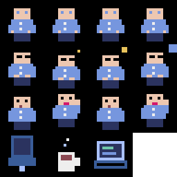

# 👾 Agent Team - 8-Bit Virtual Office CLI & Web Server

**Agent Team** คือ CLI และ Localhost Web Server จำลองออฟฟิศสไตล์ **8-bit Pixel Art Animation** แบบเรียลไทม์ สำหรับแสดงสถานะของ **AI Agents** (เช่น Claude Code, Autonomous Subagents, Dev Agents, Potato-Skill Agents) ขณะนั่งเขียนโค้ด ประชุม รอคิว หรือพักผ่อนบนเว็บเบราว์เซอร์ พร้อมระบบเสียง Retro Synth และระบบ Background Daemon ในตัว



---

## 🌟 จุดเด่นและฟีเจอร์หลัก (Key Features)

### 1. 🏢 Tech Startup Open-Plan Office & 5 Conference Rooms
- **ห้องทำงานแบบ Open Space (ซ้ายมือ)**:
  - **โต๊ะยาว 5 ตัว (5 Long Benches)**: แต่ละโต๊ะนั่งได้ **8 คน** (รองรับทีมงานสูงสุด 40 ที่นั่ง)
    - `Bench 1`: Core Tech & Product
    - `Bench 2`: Frontend & UI
    - `Bench 3`: Backend & API
    - `Bench 4`: AI & Data / QA
    - `Bench 5`: DevOps & Infra / SRE
  - **อุปกรณ์ประจำโต๊ะ**: แล็ปท็อปพร้อมหน้าจอโค้ดเคลื่อนไหว, เก้าอี้ทำงานตามสีธีม, แก้วกาแฟร้อน และกระป๋อง Energy Drink
  - **ป้ายชื่อตั้งโต๊ะประจำตัว (Desk Nameplate)**: สลักชื่อ Agent ทุกตัวอย่างชัดเจนบริเวณหน้าโต๊ะทำงาน
  - **ของตกแต่งออฟฟิศ Startup**: ไวท์บอร์ด Kanban Board (TODO, DOING, PROD), บาร์กาแฟ & ตู้แช่เครื่องดื่ม, ป้ายนีออนเรืองแสง `MOVE FAST & BREAK THINGS`, ตู้เกมเรโทร Arcade, ต้นไม้ Monstera และตู้เซิร์ฟเวอร์ไฟกะพริบ
- **โซนห้องประชุม 5 ห้อง (ขวามือ)**:
  - **ห้องประชุม 1 ถึง 5**: ทุกห้องรองรับได้สูงสุด **8 ที่นั่งต่อห้อง** (รวมรองรับประชุมพร้อมกันได้ถึง 40 ที่นั่ง)
    - `Room 1`: Executive Suite 1
    - `Room 2`: Executive Suite 2
    - `Room 3`: Executive Suite 3
    - `Room 4`: Executive Suite 4
    - `Room 5`: Main Boardroom (ห้องประชุมใหญ่สำหรับ All-Hands)
  - **อุปกรณ์ในห้องประชุม**: โต๊ะประชุมไม้หรูวงรี, คอนโซลไมโครโฟนตรงกลาง, เก้าอี้ประชุม 8 ตัว, ไฟสถานะ LED (เขียว = ว่าง, ส้ม = กำลังประชุม, แดงกะพริบ = ห้องเต็ม 8/8) และป้ายแสดงหัวข้อประชุม
  - **ป้ายชื่อบนโต๊ะประชุม (Meeting Name Badges)**: วางระบุชื่อผู้เข้าร่วมประชุมชัดเจนทุกคนรอบโต๊ะ

---

### 2. 🪪 การแสดงชื่อ Agent ชัดเจน 100% (High-Legibility Identity)
- ตัวหนังสือไม่โดนแล็ปท็อปหรือเฟอร์นิเจอร์ทับซ้อน
- ใช้ฟอนต์ 8-bit คมชัดระดับพิกเซล `Silkscreen` อ่านง่าย ชัดเจน ไม่มีการตัดคำเป็น `...`

---

### 3. 📊 กล่องข้อความ Task HUD & หลอด Progress Bar
- เมื่อ Agent ทำงาน (`status: working`) จะมีกล่อง HUD ลอยเหนือศีรษะ:
  - แสดง**ชื่อ Agent** ชัดเจน
  - แสดง**เปอร์เซ็นต์ความคืบหน้า (0 - 100%)**
  - หลอด **Progress Bar** 8-bit สีเหลือง/เขียวเมื่อเสร็จ
  - คำอธิบายงาน (Task Description) ที่กำลังทำอยู่

---

### 4. 🧍 ท่าทางตัวละครที่นุ่มนวล สมจริง (Polished Animations)
- **💻 ทำงาน (Working)**: ตัวละครนั่งนิ่งเป็นธรรมชาติ **ขยับเฉพาะนิ้วมือพิมพ์คีย์บอร์ด** และหน้าจอแล็ปท็อปสว่างสะท้อนใบหน้า (ตัวคนไม่เด้งขึ้นลงเร็วผิดปกติ)
- **💤 นอนหลับ (Sleeping)**: หลับสัปหงกพร้อมสัญลักษณ์ `Z` `z` `z` ลอยขึ้นเป็นคลื่น Sine Wave
- **💬 สนทนา (Talking)**: ขยับปาก โบกมือสื่อสาร พร้อมกล่องคำพูด (Speech Bubble) เหนือศีรษะ โดยในห้องประชุมจะมีการสลับผู้พูดทีละคนอย่างเป็นธรรมชาติ
- **⏳ รอคิวประชุม (Waiting)**: นั่งรอเรียบร้อยที่โต๊ะทำงาน พร้อมป้ายสีเหลืองอำพันและนาฬิกาทราย `⏳ QUEUE FOR RM X`

---

### 5. 👥 ระบบ Lifecycle 1:1 ตรงตาม Agent ที่ทำงานจริง
- จำนวน Agent ที่ปรากฏในออฟฟิศจะตรงกับ Agent ที่กำลังรันงานจริงเท่านั้น
- หากไม่ได้สั่งรันหรือยังไม่มีงาน ออฟฟิศจะโล่งสะอาด
- เมื่อ Agent จบงาน หรือไม่ต้องการให้แสดงผล สามารถใช้คำสั่ง **Dismiss** เพื่อให้ตัวละครหายไปพร้อมเอฟเฟกต์กลุ่มควัน 8-bit Smoke Puff

---

### 6. 🚦 ระบบตรวจสอบสถานะห้องประชุม และระบบรอคิว (Meeting Room Queue System)
- **ห้องประชุมจุได้ห้องละ 8 คน** หากมีคำสั่งเรียกประชุมแล้วห้องนั้นเต็ม (ครบ 8 คน):
  - ระบบจะนำ Agent เข้าสู่ **Waiting Queue** ให้อัตโนมัติ พร้อมแจ้ง Queue ID และลำดับคิว
  - Agent จะนั่งรออยู่ที่โต๊ะทำงานในสถานะ `waiting`
  - หน้าจอเว็บจะแสดงป้าย `⏳ QUEUE ACTIVE` สีเหลืองอำพันแบบ Cyber Retro
- **ระบบ Auto-Admit**:
  - เมื่อการประชุมในห้องเดิมสิ้นสุดลง (`agent-team end-meeting -r <room>`)
  - **ระบบจะดึง Agent ในคิวที่รอห้องนั้นเข้าห้องประชุมทันทีโดยอัตโนมัติ!**
- **คำสั่งจัดการคิว**:
  - ตรวจสอบสถานะห้องและคิวทั้งหมด: `agent-team room-status` (หรือ `agent-team status`)
  - จองคิวล่วงหน้าโดยตรง: `agent-team queue-meeting <names...> -r <room>`
  - ขอยกเลิกคิว: `agent-team cancel-queue <queueIdOrAgent>`

---

### 7. 🚶 ระบบเดินไปคุย / ถามข้อมูลที่โต๊ะทำงาน (Desk Visit & Consultation)
- Agent สามารถ**ลุกจากโต๊ะทำงาน แล้วเดินเลี้ยวไปตามช่องทางเดิน (Hallways & Aisles)** ด้วยแอนิเมชันก้าวขาแกว่งแขน 8-bit เดินไปหาเพื่อนร่วมทีมที่โต๊ะอื่นได้
- **ท่าทางยืนปรึกษางาน (Visiting Pose)**: ยืนถือแผ่นชาร์ต/สมุดโน้ตข้างโต๊ะเพื่อน พร้อมบอลลูนคำถาม `❓ [question]` ลอยเด่นเหนือศีรษะ
- **บอลลูนคำตอบโต้ตอบ (Reply Bubble)**: Agent เจ้าของโต๊ะที่นั่งอยู่จะตอบกลับด้วยบอลลูน `💡 [reply]` (วางตำแหน่งเยื้องซ้าย-ขวาอย่างลงตัว ไม่บังกัน)
- **สถานะเก้าอี้และโต๊ะ**: ระหว่างที่ลุกไปคุย เก้าอี้ทำงานของตัวที่เดินจะว่างลงอย่างสมจริง
- **การเดินกลับ (Auto-Return / Manual Return)**:
  - เดินกลับเองอัตโนมัติเมื่อครบเวลา (ดีฟอลต์ 12 วินาที)
  - หรือสั่งให้อยู่ค้างไว้ (`--stay`) แล้วสั่งเดินกลับเมื่อไหร่ก็ได้ด้วยคำสั่ง `agent-team return <visitor>`
  - เมื่อกลับถึงโต๊ะจะนั่งลงทำงานพิมพ์โค้ดต่อทันที

---

## 🚀 การติดตั้งและเริ่มต้นใช้งาน (Getting Started)

### ความต้องการของระบบ (Prerequisites)
- **Node.js**: เวอร์ชัน 18 ขึ้นไป
- **npm**

### การติดตั้ง (Installation)
```bash
git clone <repo-url>
cd agent_team
npm install
npm run build
```

### เปิดหน้าจอ Virtual Office
```bash
# เปิดเซิร์ฟเวอร์และเปิดบราวเซอร์ให้อัตโนมัติ (localhost:3333)
node bin/agent-team.js open
# หรือ
node bin/agent-team.js start --open
```

> **หมายเหตุ:** ระบบมี **Background Auto-Daemon** ในตัว หากเซิร์ฟเวอร์ยังไม่ได้เปิด เมื่อพิมพ์คำสั่ง CLI ใดๆ ระบบจะสตาร์ทเซิร์ฟเวอร์เบื้องหลังให้เองทันที!

---

## 📖 คู่มือคำสั่ง CLI ทั้งหมด (CLI Reference)

### 1. 🏢 การตรวจสอบสถานะ (Status & Roster)

#### `agent-team room-status [roomNumber]`
> **Aliases:** `status`, `meet-status`, `rooms`

ตรวจสอบสถานะห้องประชุมทั้ง 5 ห้อง (ความจุ, จำนวนผู้เข้าร่วม, หัวข้อ) และรายการคิวที่รอใช้ห้อง (`Waiting Queue`):
```bash
# ตรวจสอบสถานะทุกห้องประชุมและคิว
agent-team room-status

# ตรวจสอบเฉพาะห้องที่ต้องการ (เช่น ห้อง 1)
agent-team room-status 1
```

**ตัวอย่างผลลัพธ์:**
```text
🏢 MEETING ROOMS & RESERVATION STATUS (Capacity: 8 seats per room)
════════════════════════════════════════════════════════════════════════════════════════
ROOM   | NAME                 | STATUS         | SEATS   | TOPIC / ATTENDEES
────────────────────────────────────────────────────────────────────────────────────────
RM 1   | Executive Suite 1    | 🔴 FULL (8/8)  | [8/8]   | "Sprint Planning" -> [dev1, dev2, dev3, ...]
RM 2   | Executive Suite 2    | 🟢 AVAILABLE   | [0/8]   | (None)
RM 3   | Executive Suite 3    | 🟡 IN USE      | [2/8]   | "QA Review" -> [qa1, devops1]
RM 4   | Executive Suite 4    | 🟢 AVAILABLE   | [0/8]   | (None)
RM 5   | Main Boardroom       | 🟢 AVAILABLE   | [0/8]   | (None)
════════════════════════════════════════════════════════════════════════════════════════

⏳ MEETING WAITING QUEUE (1 meeting request waiting):
────────────────────────────────────────────────────────────────────────────────────────
  #1 [Q-860] Target: Room 1           | Topic: "Security Audit"
     Waiting Agents: [coder1, reviewer1] (Queued: just now)
────────────────────────────────────────────────────────────────────────────────────────
💡 Note: When a room is freed (via "agent-team end-meeting <room>"), the next waiting team is automatically admitted!
```

#### `agent-team list`
แสดงรายชื่อ Agent ทั้งหมดที่กำลังทำงานอยู่ในออฟฟิศ พร้อมระบุโต๊ะทำงาน ห้องประชุม และความคืบหน้า:
```bash
agent-team list
```

---

### 2. 💻 การสั่งงานและอัปเดตความคืบหน้า (Work & Progress)

#### `agent-team work <name> [task...] [-P <progress>]`
สั่งให้ Agent นั่งทำงานหน้าแล็ปท็อป (หาก Agent ตัวนั้นยังไม่มีในระบบ จะทำ **Auto-Spawn** ให้ทันที ไม่ต้องสั่ง `spawn` ล่วงหน้า):
```bash
# สั่งให้ coder1 ทำงาน (ดีฟอลต์ความคืบหน้า 25%)
agent-team work coder1 "Refactoring auth module"

# สั่งงานพร้อมระบุเปอร์เซ็นต์ความคืบหน้า 70%
agent-team work coder1 "Writing unit tests" -P 70
```

#### `agent-team progress <name> <percentage> [task...]`
อัปเดตเปอร์เซ็นต์ความคืบหน้าของงาน (0 - 100%):
```bash
# อัปเดตความคืบหน้าเป็น 90%
agent-team progress coder1 90

# อัปเดตพร้อมเปลี่ยนคำอธิบายงาน
agent-team progress coder1 100 "Auth module completed!"
```

---

### 3. 📋 การประชุมและระบบเข้าคิว (Meetings & Queue)

#### `agent-team meet <names...> [-r <1-5>] [-t <topic>]`
ย้าย Agent ไปยังห้องประชุม (1 - 5):
- แต่ละห้องรองรับได้สูงสุด **8 คน**
- หากห้องว่าง จะเข้าประชุมทันที
- **หากห้องเต็ม (ครบ 8 คน) ระบบจะนำเข้า Waiting Queue ให้อัตโนมัติ!**
```bash
# ส่ง dev1, dev2 เข้าห้องประชุม 1
agent-team meet dev1 dev2 -r 1 -t "API Design Review"

# ส่ง 8 คนเข้าห้องประชุม 5 (Boardroom)
agent-team meet dev1 dev2 dev3 dev4 dev5 dev6 dev7 dev8 -r 5 -t "All-Hands Sync"

# หากห้อง 1 เต็มอยู่แล้ว แล้วสั่งเรียกประชุม:
agent-team meet qa1 devops1 -r 1 -t "Canary Verification"
# -> ระบบจะแจ้งว่าห้องเต็ม และนำเข้าคิว #1 ให้ทันที
```

#### `agent-team queue-meeting <names...> [-r <1-5>] [-t <topic>]`
> **Alias:** `q-meet`

สั่งจองคิวห้องประชุมโดยตรง:
```bash
agent-team queue-meeting coder1 reviewer1 -r 2 -t "Code Review RFC"
```

#### `agent-team cancel-queue <queueIdOrAgent>`
> **Alias:** `dequeue`

ขอยกเลิกคำขอเข้าคิวประชุม (ระบุ Queue ID เช่น `Q-860` หรือระบุชื่อ Agent ที่รอคิวอยู่):
```bash
# ยกเลิกด้วย Queue ID
agent-team cancel-queue Q-860

# ยกเลิกด้วยชื่อ Agent
agent-team cancel-queue coder1
```

#### `agent-team end-meeting [args...] [-r <1-5>]`
สั่งจบการประชุม:
- Agent ในห้องประชุมจะหายไปทันทีพร้อมเอฟเฟกต์ควัน 8-bit Smoke Puff
- **หากมีคิวรออยู่ ระบบจะดึง Agent ในคิวเข้าห้องประชุมทันที (Auto-Admit)!**
```bash
# สั่งจบการประชุมเฉพาะห้อง 1
agent-team end-meeting -r 1
# หรือ
agent-team end-meeting 1

# สั่งจบการประชุมทุกห้อง
agent-team end-meeting
```

---

### 4. 💤 การพักและการพูดคุย (Sleep & Talk)

#### `agent-team sleep <name>`
สั่งให้ Agent นั่งหลับพักผ่อน (มีตัวอักษร Zzz ลอย):
```bash
agent-team sleep dev1
```

#### `agent-team talk <name> <message...>`
ให้ Agent พูดคุยและแสดง Speech Bubble:
```bash
agent-team talk pm1 "Let's review the sprint goals!"
```

---

### 5. 🚶 การเดินไปคุย / ปรึกษาที่โต๊ะทำงาน (Desk Visit & Consultation)

#### `agent-team ask <from> <to> [question...] [options]`
> **Aliases:** `visit`, `consult`, `walk-to`, `talk-to`

สั่งให้ Agent ลุกจากโต๊ะ เดินไปหาเพื่อนร่วมทีมที่โต๊ะทำงาน เพื่อสอบถามข้อมูลหรือปรึกษางาน:
- **Options**:
  - `-r, --reply <text>`: ข้อความที่ Agent เจ้าของโต๊ะตอบกลับ (หากไม่ระบุ ระบบจะตอบกลับตามชิ้นงานที่กำลังทำอยู่ให้อัตโนมัติ)
  - `-d, --duration <seconds>`: ระยะเวลาที่ยืนปรึกษาก่อนเดินกลับโต๊ะตัวเอง (ดีฟอลต์: 12 วินาที)
  - `-s, --stay`: สั่งให้ยืนคุยค้างไว้ ไม่เดินกลับอัตโนมัติ (จนกว่าจะสั่ง `agent-team return`)

```bash
# pm1 ลุกจากโต๊ะเดินไปถาม coder1 ที่โต๊ะ
agent-team ask pm1 coder1 "Is auth ready?"

# เดินไปปรึกษาพร้อมระบุคำตอบ และตั้งเวลาคุย 20 วินาที
agent-team ask pm1 coder1 "When can we release?" -r "Sprint target is Friday!" -d 20

# เดินไปปรึกษาแบบยืนคุยค้างไว้ (ไม่เดินกลับจนกว่าจะสั่ง return)
agent-team ask system-architect1 coder1 "Review the API contract" --stay
```

#### `agent-team return <visitor>`
> **Aliases:** `back-to-desk`, `return-to-desk`

สั่งให้ Agent ที่กำลังไปยืนคุย เดินกลับมานั่งทำงานที่โต๊ะของตัวเองทันที:
```bash
# สั่งให้ pm1 เดินกลับไปนั่งทำงานที่โต๊ะตัวเอง
agent-team return pm1
```

---

### 6. 🚪 การคัดชื่อออกและเคลียร์ออฟฟิศ (Dismiss & Reset)

#### `agent-team dismiss [names...] [--idle] [--sleeping]`
> **Aliases:** `remove`, `leave`, `despawn`

สั่งให้ Agent หายตัวไปพร้อมเอฟเฟกต์ควัน 8-bit:
```bash
# สั่งลบเฉพาะ Agent ที่ระบุ
agent-team dismiss dev1 dev2

# สั่งลบ Agent ทั้งหมดที่ไม่ได้กำลังทำงาน (กำลังหลับหรือว่าง)
agent-team dismiss --idle

# สั่งลบ Agent ทั้งหมดที่กำลังนอนหลับ
agent-team dismiss --sleeping
```

#### `agent-team reset`
ล้างทำความสะอาดออฟฟิศทั้งหมด นำ Agent และหัวข้อประชุมออกทั้งหมด:
```bash
agent-team reset
```

---

### 7. 🥔 การทำงานร่วมกับ Potato-Skill Agents

ระบบรองรับ Potato-Skill Agents ทั้ง 10 บทบาทจาก `/Users/kittisak/workspace/potato-skill/agents`:

| Agent Name | Role Title | สีประจำตัว | โต๊ะทำงานเริ่มต้น | หน้าที่หลัก |
|---|---|---|---|---|
| `product-manager` | `PM` | 🟣 Purple | Bench 1 (Core Tech & Product) | Drafting PRD & Acceptance Criteria |
| `project-planner` | `PLANNER` | 🟢 Green | Bench 1 (Core Tech & Product) | Decomposing task DAG waves |
| `system-architect` | `ARCHITECT` | 🔵 Blue | Bench 1 (Core Tech & Product) | Designing contracts & OpenAPI specs |
| `ui-ux-designer` | `UI/UX` | 🌸 Magenta | Bench 2 (Frontend & UI) | Building IA & wireframe screen flow |
| `design-to-code` | `UI DEV` | 🩵 Teal | Bench 2 (Frontend & UI) | Decomposing tokens to components |
| `coder` | `CODER` | 🟠 Orange | Bench 3 (Backend & API) | Implementing production code & tests |
| `code-reviewer` | `REVIEWER` | 🔴 Red | Bench 3 (Backend & API) | Verifying AST & security rules |
| `qa-tester` | `QA` | 🟡 Yellow | Bench 4 (QA & SRE) | Synthesizing fuzz & property tests |
| `runtime-sre` | `SRE` | 🩷 Pink | Bench 4 (QA & SRE) | Analyzing SLO telemetry & RCA |
| `devops-release` | `DEVOPS` | 🌐 Cyan | Bench 5 (DevOps & Infra) | Canary rollout & CI/CD deployment |

#### คำสั่ง CLI สำหรับ Potato Squad:
```bash
# แสดงรายชื่อและคำอธิบายของ Potato Agents ทั้ง 10 ตัว
agent-team potato-list

# เสกทั้งทีม 10 คนมานั่งประจำโต๊ะทำงานตามสายงานทันที
agent-team spawn-potato

# เสกเฉพาะตัวที่ต้องการ (รองรับ auto-numbering เช่น coder1, coder2)
agent-team spawn-potato coder system-architect qa-tester

# รันขั้นตอนการประชุมอัตโนมัติตาม Flow ของ Potato-Skill:
agent-team potato-workflow review     # coder1 & code-reviewer1 ประชุมห้อง 1 (Review AST)
agent-team potato-workflow arch       # product-manager1 & system-architect1 ประชุมห้อง 2 (PRD Contract)
agent-team potato-workflow qa         # qa-tester1 & devops-release1 ประชุมห้อง 3 (Canary Rollout)
agent-team potato-workflow triage     # runtime-sre1 & coder1 ประชุมห้อง 4 (Incident Hotfix)
agent-team potato-workflow all-hands  # รวมทีม 8 คนเข้าห้อง 5 Boardroom (DAG Wave Planning)
```

---

### 8. 🎨 การสร้าง Pixel Art Assets ด้วย Pyxel & ImageMagick

โปรเจกต์นี้มี Toolchain อัตโนมัติสำหรับ Generate ตัวละครและ Spritesheet:
```bash
# รัน Toolchain สร้าง Spritesheet, GIFs และ Metadata
agent-team generate-assets

# เปิดโปรแกรมแก้ไข Pixel Art Retro GUI (Pyxel)
agent-team pyxel-edit
```
- Assets ที่ถูกสร้างจะอยู่ที่ `public/assets/`
- สามารถกดปุ่ม **🖼️ SPRITES & GIFS** ที่หน้าเว็บเพื่อดูแกลเลอรีภาพเคลื่อนไหวได้

---

## 🤖 การเชื่อมต่อกับ Claude Code / AI Agents (Integration)

สามารถสั่งการ Virtual Office ได้ 2 รูปแบบ:

### รูปแบบที่ 1: ผ่าน Shell CLI (แนะนำสำหรับ Claude Code / Subagents)
ใส่คำสั่งในสคริปต์, Makefile หรือ Tool Execution ของ Agent:
```bash
# 1. เมื่อเริ่มงาน
agent-team work coder1 "Implementing JWT Auth" -P 20

# 2. เมื่อทำงานไประยะหนึ่ง
agent-team progress coder1 75 "Writing unit tests"

# 3. เมื่อต้องการเดินไปถามข้อมูลหรือปรึกษาเพื่อนที่โต๊ะ
agent-team ask pm1 coder1 "Is auth ready?" -r "Finishing up tests!"

# 4. เมื่อต้องการประชุมทีม
agent-team meet coder1 reviewer1 -r 1 -t "JWT Code Review"

# 5. เมื่อประชุมเสร็จ
agent-team end-meeting -r 1

# 6. เมื่อทำงานเสร็จสิ้น ปิดงาน
agent-team dismiss coder1
```

### รูปแบบที่ 2: ผ่าน REST API (JSON HTTP Endpoints)
พอร์ตมาตรฐานคือ `3333`:

| Method | Endpoint | Body Payload ตัวอย่าง | คำอธิบาย |
|---|---|---|---|
| `GET` | `/api/health` | - | ตรวจสอบสถานะเซิร์ฟเวอร์ |
| `GET` | `/api/agents` | - | ดึงข้อมูล Agent และห้องประชุมทั้งหมด |
| `GET` | `/api/meeting-rooms/status` | `?roomId=1` (Optional) | ดึงสถานะห้อง 1-5 และคิวที่รอ |
| `GET` | `/api/agents/visits` | - | ดึงรายการ Session การเดินคุยทั้งหมด |
| `POST` | `/api/agents/work` | `{"name": "coder1", "task": "Coding", "progress": 50}` | สั่งทำงาน (Auto-Spawn หากยังไม่มี) |
| `POST` | `/api/agents/progress` | `{"name": "coder1", "progress": 80, "task": "Testing"}` | อัปเดตความคืบหน้า |
| `POST` | `/api/agents/visit` | `{"from": "pm1", "to": "coder1", "question": "Ready?", "reply": "Yes", "duration": 12, "stay": false}` | สั่งเดินไปถามข้อมูลที่โต๊ะ |
| `POST` | `/api/agents/return` | `{"name": "pm1"}` | สั่งให้เดินกลับโต๊ะทำงาน |
| `POST` | `/api/agents/meet` | `{"names": ["coder1", "reviewer1"], "room": 1, "topic": "Review"}` | เรียกประชุม (Auto-Queue หากเต็ม) |
| `POST` | `/api/agents/end-meeting`| `{"room": 1}` | จบการประชุม (Auto-Admit คิวถัดไป) |
| `POST` | `/api/meeting-rooms/queue`| `{"names": ["qa1"], "room": 1, "topic": "Test"}` | สั่งเข้าคิวประชุมโดยตรง |
| `POST` | `/api/meeting-rooms/dequeue`| `{"id": "Q-860"}` หรือ `{"name": "qa1"}` | ยกเลิกคิว |
| `POST` | `/api/agents/sleep` | `{"name": "coder1"}` | สั่งนอนพัก |
| `POST` | `/api/agents/talk` | `{"name": "coder1", "message": "Hello!"}` | ส่งข้อความพูดคุย |
| `POST` | `/api/agents/remove` | `{"names": ["coder1"], "idle": false, "sleeping": false}` | สั่งให้ Agent หายไป (Dismiss) |
| `POST` | `/api/reset` | `{}` | ล้างข้อมูล Agent ทั้งหมด |

---

## 🗂️ โครงสร้างโปรเจกต์ (Project Directory Layout)

```text
agent_team/
├── bin/
│   └── agent-team.js          # CLI Executable Entrypoint
├── public/                    # 8-Bit Web Dashboard Frontend
│   ├── index.html             # โครงสร้างหน้าเว็บ, CRT Effect, Canvas
│   ├── style.css              # Cyber 8-bit Dark Theme
│   ├── audio.js               # Web Audio API Synthesizer (SFX)
│   ├── sprites.js             # ตัวเรนเดอร์พิกเซล (Agent, Badges, Furniture, Laptops)
│   ├── app.js                 # เอนจินเกม, WebSocket Sync, Particle System
│   └── assets/                # Spritesheet, GIFs, Icons
├── src/
│   ├── cli/
│   │   └── index.ts           # คำสั่ง CLI ผ่าน Commander.js
│   └── server/
│       ├── types.ts           # Type Definitions (Agent, Queue, RoomStatus, WebSocket)
│       ├── state.ts           # StateManager จัดการคิว, ที่นั่ง, Auto-Admit, Lifecycle
│       ├── server.ts          # Express Server & WebSocket Server
│       ├── potato-agents.js   # ข้อมูล Agent จาก potato-skill/agents
│       └── standalone.ts      # สคริปต์รันเซิร์ฟเวอร์แบบ Background Daemon
├── tools/
│   ├── pixel_engine.py        # Pyxel Engine Script สร้างเฟรมตัวละคร
│   └── imagemagick_pipeline.sh# ImageMagick Script รวม Spritesheet & GIFs
├── package.json
├── tsconfig.json
└── README.md                  # เอกสารคู่มือการใช้งานฉบับสมบูรณ์
```

---

## 📄 ลิขสิทธิ์ (License)
MIT License
